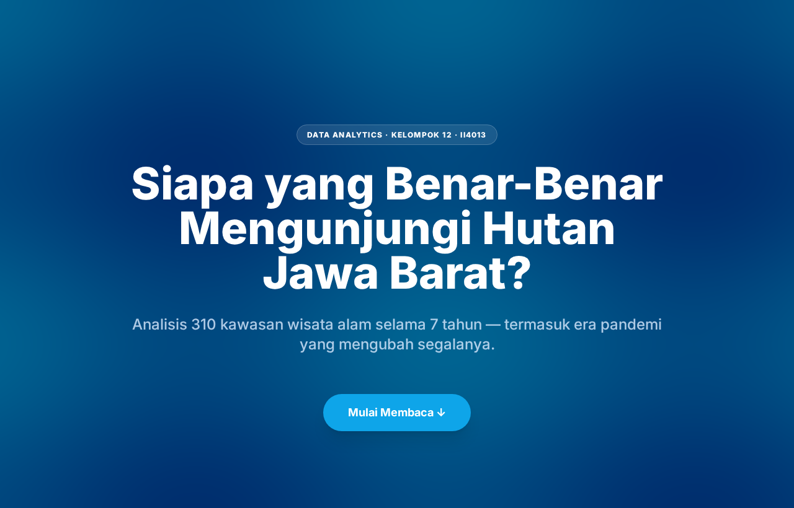
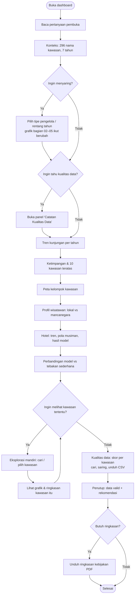
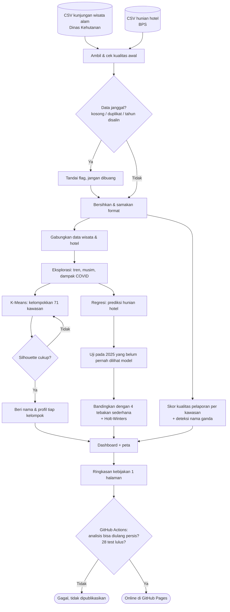
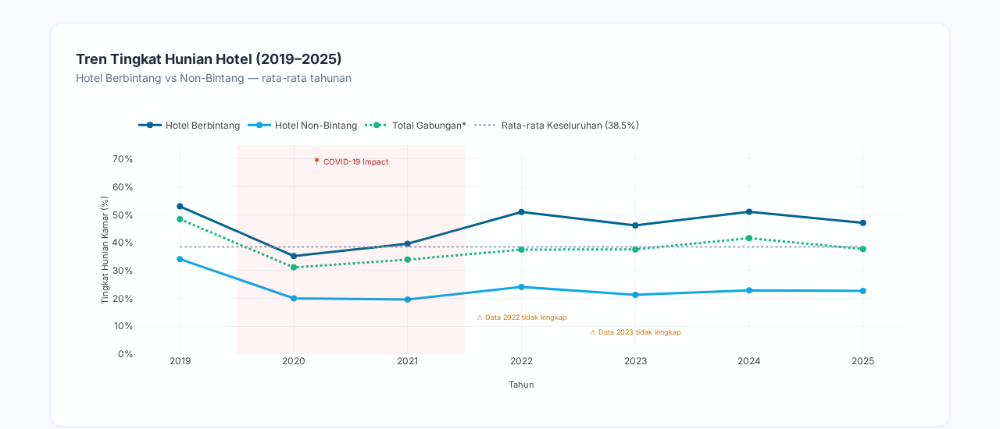
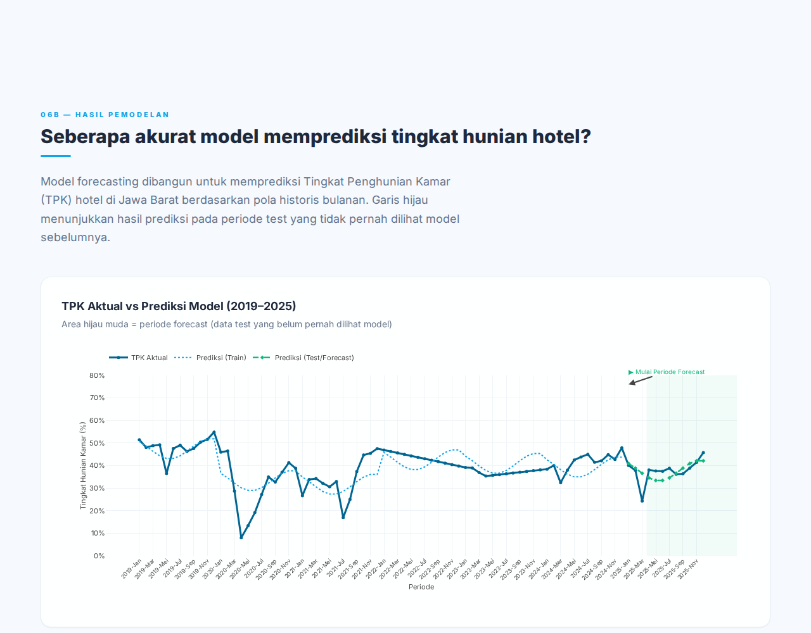
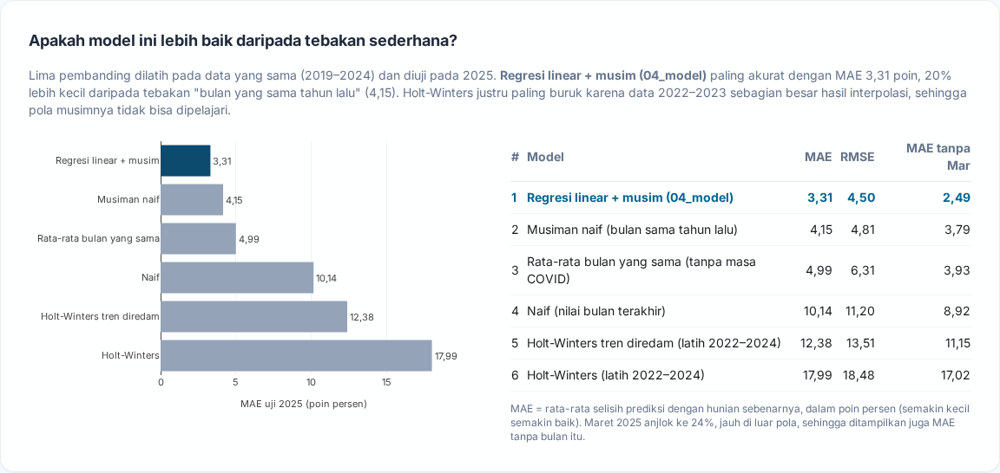
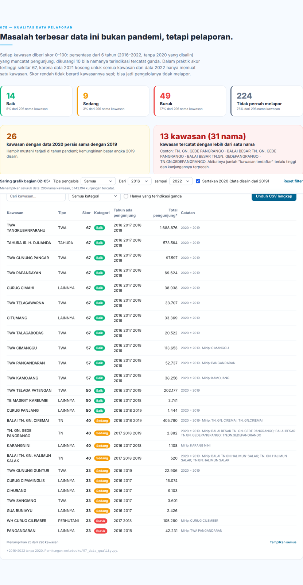
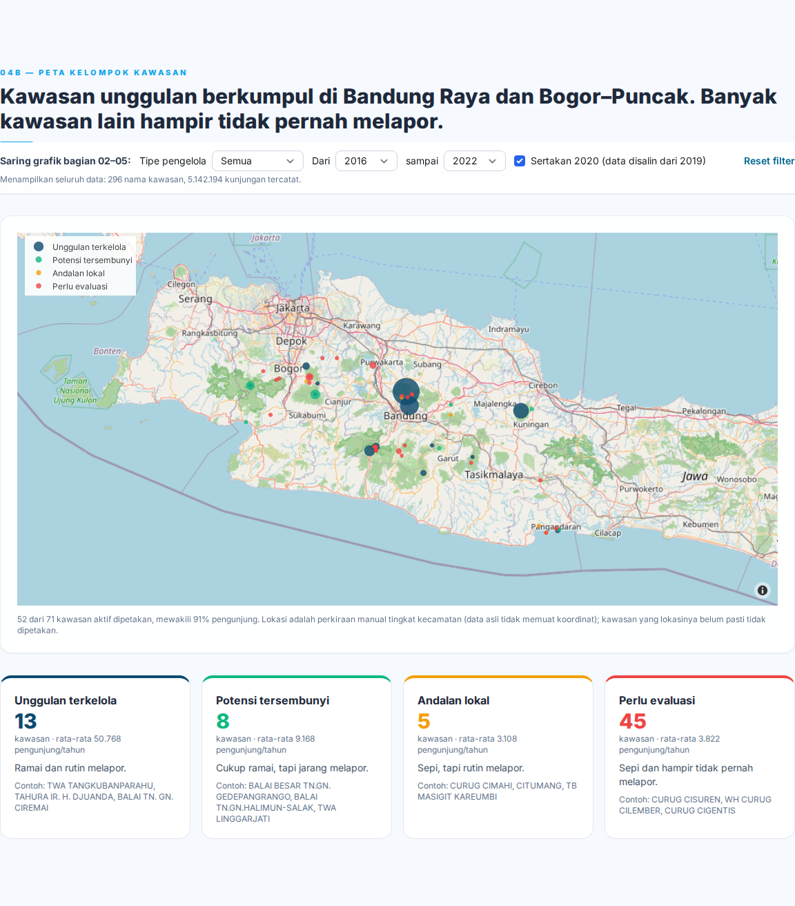
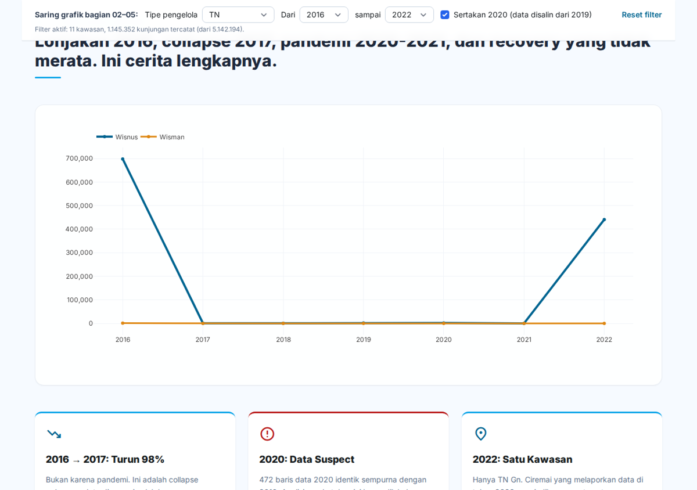
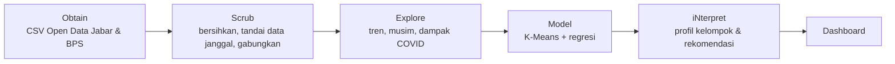

# Pariwisata Alam Jawa Barat: Analisis Data

**Siapa yang benar-benar mengunjungi hutan Jawa Barat?** Proyek ini menelusuri data kunjungan **296 nama kawasan wisata alam** (2016–2022) dan **tingkat hunian kamar (TPK) hotel** (2019–2025) di Jawa Barat. Hasilnya disajikan sebagai dashboard bercerita.

**Dashboard:** https://rivaldimhr.github.io/jabar-tourism/ (bisa langsung dicoba, tanpa instalasi)
**Ringkasan 1 halaman untuk pembuat kebijakan (PDF):** https://rivaldimhr.github.io/jabar-tourism/ringkasan-kebijakan.pdf



## Singkatnya

Data kunjungan wisata alam Jawa Barat ternyata **lebih banyak bercerita tentang siapa yang rajin melapor daripada siapa yang berkunjung**. Proyek ini membersihkan data tersebut, menandai tahun-tahun yang tidak bisa dipercaya, lalu menjawab tiga pertanyaan:

1. Kawasan mana yang benar-benar ramai, dan mana yang hanya terdaftar?
2. Seberapa besar dampak COVID, baik ke wisata alam maupun ke hotel?
3. Kawasan mana yang perlu dikembangkan dan mana yang perlu dievaluasi?

## Diagram aktivitas: memakai dashboard



## Diagram aktivitas: dari data mentah ke dashboard



## Temuan utama

- **Ketimpangan ekstrem.** TWA Tangkubanparahu menyumbang **33,4%** seluruh kunjungan tercatat, dan 5 kawasan teratas menyumbang **65,0%**. Sebanyak **224 nama kawasan** tidak pernah mencatat satu pengunjung pun.
- **Hampir semuanya wisatawan lokal.** Wisatawan mancanegara hanya **1,9%** dari total kunjungan.
- **Masalah data lebih besar dari masalah pandemi.** Penurunan 98% dari 2016 ke 2017 terjadi karena banyak kawasan berhenti melapor, bukan karena pengunjungnya hilang. Data 2020 di 26 kawasan sama persis dengan 2019, sehingga diduga hasil salin. Pada 2022 hanya satu kawasan yang melapor. Selain itu, **13 kawasan tercatat dengan beberapa nama** (31 nama). Taman Nasional Gede Pangrango, misalnya, punya 4 ejaan, sehingga "296 kawasan" sebenarnya lebih sedikit dan kunjungannya terpecah.
- **Hotel ikut terpukul saat COVID.** Rata-rata hunian hotel berbintang turun dari 53% (2019) ke 35% (2020). Bulan terpadat adalah **Desember**, yang tersepi **April–Mei**.



## Model

### 1. Pengelompokan kawasan (K-Means, k = 4)

Model ini mengelompokkan 71 kawasan yang punya data kunjungan, berdasarkan rata-rata pengunjung per tahun, jumlah tahun aktif melapor, dan rasio wisatawan mancanegara.

| Kelompok | Jumlah | Ciri | Contoh |
|---|---|---|---|
| Unggulan terkelola | 13 | ±50 rb pengunjung/tahun, rutin melapor | Tangkubanparahu, Tahura Djuanda |
| Potensi tersembunyi | 8 | ±9 rb/tahun, jarang melapor | TN Gede Pangrango, Halimun-Salak |
| Andalan lokal | 5 | ±3 rb/tahun, rutin melapor | Curug Cimahi, Citumang |
| Perlu evaluasi | 45 | ±4 rb/tahun, hampir tidak pernah melapor | Curug Cisuren, Curug Cigentis |

**Silhouette score: 0,67.** Kelompoknya cukup terpisah. k = 5 sedikit lebih tinggi (0,68), tetapi k = 4 dipilih karena tiap kelompoknya lebih mudah dijelaskan.

### 2. Prediksi hunian hotel (regresi linear)

Fitur yang dipakai: tren tahun, pola bulan (sin/cos), dan penanda masa COVID. Model dilatih pada data 2019–2024 (72 bulan) dan diuji pada 2025 (12 bulan) yang belum pernah dilihatnya.

| Metrik (uji 2025) | Nilai |
|---|---|
| MAE | **3,3 poin persen** |
| RMSE | 4,5 poin persen |
| R² | 0,11 (latih: 0,51) |

Artinya, prediksinya rata-rata meleset sekitar 3 poin dari hunian sebenarnya (misalnya memprediksi 38% saat aktualnya 41%). Model ini cukup baik menangkap tingkat rata-rata dan pola musim, tetapi lemah menebak naik-turun antarbulan, sehingga R² ujinya rendah. Model ini dipakai untuk **menjelaskan pola**, bukan untuk peramalan yang presisi. Dari koefisiennya:

- Masa COVID menurunkan hunian sekitar 12,5 poin per bulan.
- Desember–Januari lebih ramai dibanding bulan lain.



#### Apakah model ini lebih baik daripada tebakan sederhana?

Model yang bagus harus mengalahkan tebakan yang tidak butuh model sama sekali. Semua pembanding di bawah dilatih pada 2019–2024 dan diuji pada 2025 (`notebooks/06_model_comparison.py`):

| # | Model | MAE uji 2025 | MAE tanpa Maret* |
|---|---|---|---|
| 1 | **Regresi linear + musim (model proyek)** | **3,31** | **2,49** |
| 2 | Musiman naif: bulan yang sama tahun lalu | 4,15 | 3,79 |
| 3 | Rata-rata bulan yang sama (tanpa masa COVID) | 4,99 | 3,93 |
| 4 | Naif: semua bulan = Desember 2024 | 10,14 | 8,92 |
| 5 | Holt-Winters, tren diredam | 12,38 | 11,15 |
| 6 | Holt-Winters | 17,99 | 17,02 |

\*Maret 2025 anjlok ke 24%, jauh di luar pola, jadi ditampilkan juga hasil tanpa bulan itu.

- **Regresi menang**: meleset 20% lebih sedikit daripada tebakan terbaik ("bulan yang sama tahun lalu").


- **Holt-Winters kalah jauh.** Bukan karena metodenya buruk, tetapi karena data latihnya: TPK 2022–2023 di seri ini sebagian besar hasil interpolasi garis lurus (data asli 2022 kosong dan 2023 hanya 4 bulan). Model deret waktu murni belajar dari garis buatan itu lalu memperpanjang tren naik 2024. Ini bukti lain bahwa kualitas data menentukan hasil.

## Skor kualitas data pelaporan

`notebooks/07_data_quality.py` memberi tiap kawasan skor 0–100:

- **Skor** = persentase dari 6 tahun (2016–2022, tanpa 2020 yang disalin) yang mencatat pengunjung. Kawasan yang tidak tercantum di suatu tahun dihitung tidak melapor.
- **−10** bila nama kawasan mirip kawasan lain, setelah awalan seperti TWA/TN/WH/Balai dan tanda baca dibuang.
- **Kategori:** Baik (≥ 50), Sedang (25–49), Buruk (1–24), Tidak pernah melapor.

| Kategori | Jumlah nama kawasan |
|---|---|
| Baik | 14 |
| Sedang | 9 |
| Buruk | 49 |
| Tidak pernah melapor | 224 |

Dalam praktik skor tertinggi sekitar 67, karena data 2021 kosong untuk semua kawasan dan 2022 hanya memuat satu kawasan. Hasil lengkapnya bisa dicari dan diunduh (CSV) dari dashboard.



## Peta

Data asli tidak memuat koordinat. Lokasi **52 dari 71 kawasan aktif** (mewakili 91% pengunjung) diisi manual sebagai perkiraan tingkat kecamatan di `data/reference/koordinat_kawasan.csv`; kawasan yang lokasinya belum pasti tidak dipetakan. Warna titik menunjukkan kelompok K-Means, ukurannya menunjukkan rata-rata pengunjung.



## Cara membaca dashboard

Dashboard disusun sebagai cerita dari atas ke bawah:

1. **Konteks dan kualitas data.** Buka panel kuning "Catatan Kualitas Data" untuk melihat tahun mana yang bermasalah.
2. **Filter** (menempel di atas saat digulir di layar lebar). Contoh: dengan filter tipe TN, grafik hanya menghitung 11 kawasan taman nasional. Pilih tipe pengelola, rentang tahun, dan sertakan atau tidak tahun 2020. Grafik dan angka di bagian 02–05 ikut berubah.
3. **Tren keseluruhan.** Grafik kunjungan wisatawan nusantara (wisnus) dan mancanegara (wisman) per tahun.
4. **Ketimpangan dan kawasan unggulan.** Angka 33,4%, 65,0%, dan 224 dihitung langsung dari data, bukan ditulis manual.
5. **Peta kelompok kawasan.** Klik nama kelompok di legenda untuk menyembunyikan atau menampilkannya.
6. **Profil wisatawan.**
7. **Hotel.** Berisi tren hunian per tahun, pola musiman, hasil model, dan perbandingan dengan tebakan sederhana. Pada grafik model, area hijau adalah tahun uji (2025).
8. **Eksplorasi mandiri.** Pilih kawasan mana pun untuk melihat datanya sendiri.
9. **Kualitas data.** Skor per kawasan; bisa dicari, disaring (mis. hanya nama ganda), dan diunduh.
10. **Penutup.** Hanya memakai tahun yang datanya bisa dipercaya, plus rekomendasi dan tombol unduh ringkasan PDF.



## Alur pengerjaan (OSEMN)



| Langkah | File |
|---|---|
| Obtain | `notebooks/01_obtain_data.py` |
| Scrub | `notebooks/02_scrub_final.ipynb` |
| Explore | `notebooks/03_explore_viz.py` |
| Model | `notebooks/04_model.ipynb` |
| Interpret | `notebooks/05_interpret.ipynb` |
| Bandingkan model | `notebooks/06_model_comparison.py` |
| Kualitas data | `notebooks/07_data_quality.py` |
| Ringkasan kebijakan | `notebooks/08_policy_brief.py` |

Hasil tiap langkah disimpan di `data/` (raw → processed → clean), `outputs/figures/`, dan `outputs/model_results/`.

### Menjalankan sendiri

```bash
pip install pandas numpy matplotlib seaborn plotly scikit-learn jupyter
# jalankan notebook 01 → 05 berurutan, lalu skrip 06 → 08:
python notebooks/06_model_comparison.py
python notebooks/07_data_quality.py
python notebooks/08_policy_brief.py
python -m http.server 8000      # dari folder repo
# buka http://localhost:8000/dashboard/dashboard.html
```

Dashboard perlu dibuka lewat server lokal (bukan klik dua kali file HTML-nya) karena membaca file CSV.

## Pengujian dan otomatisasi

Setiap push ke `main` menjalankan `.github/workflows/pages.yml`:

1. **Analisis dijalankan ulang** (skrip 06–08), lalu `git diff --exit-code` memastikan hasilnya **sama persis** dengan yang tersimpan di repo.
2. **18 test data** (`tests/test_data.py`):
   - kolom wajib ada,
   - nilai wajar (pengunjung tidak negatif, TPK 0–100, data uji hanya 2025),
   - MAE regresi sama dengan hasil notebook 04,
   - koordinat berada di Jawa Barat,
   - angka yang tertulis di dashboard dan ringkasan PDF cocok dengan data.
3. **10 test dashboard di browser** (`tests/test_dashboard.py`, Playwright):
   - 11 grafik tampil tanpa error JavaScript,
   - angka kunci dihitung benar,
   - filter tipe dan tahun mengubah grafik dengan total yang tepat,
   - tabel model dan peta lengkap,
   - pencarian dan unduhan di bagian kualitas data berfungsi,
   - PDF bisa diunduh,
   - tidak melebar di layar ponsel.
4. Bila semua lulus, situs disusun (`scripts/build_site.py --pdf`) dan dipublikasikan ke GitHub Pages.

Test-test ini sudah menemukan dua angka yang salah di dashboard versi awal:
- "5 kawasan teratas menyumbang 75,6%" ditulis manual, padahal data dan diagram di sebelahnya menunjukkan 65,0%.
- "Mei paling sepi", padahal grafiknya sendiri menunjukkan April.

```bash
pip install pandas numpy pytest playwright && python -m playwright install chromium
python -m pytest tests -v     # test browser dilewati otomatis bila tidak ada internet
```

## Keterbatasan

- Data kunjungan bergantung pada laporan pengelola. Banyak kawasan tidak melapor, sehingga angka total lebih mencerminkan kepatuhan melapor daripada jumlah pengunjung sebenarnya.
- Data TPK hotel 2022 hanya lengkap untuk hotel berbintang, dan 2023 hanya 4 bulan. Pada grafik model, bulan yang kosong tampil sebagai garis lurus hasil interpolasi.
- Model regresi sederhana dengan R² uji rendah. Gunakan untuk memahami pola, bukan sebagai angka pasti.
- Koordinat di peta adalah perkiraan manual, bukan data resmi.
- Deteksi nama ganda berbasis kemiripan teks; "Pangandaran" dan "TWA Pangandaran", misalnya, bisa saja memang dua tempat berbeda. Karena itu ditulis "kemungkinan".

## Tim

Tugas Besar **II4013 Data Analitik** ITB, Kelompok 12:

- Bastian Natanael Sibarani: integrasi sistem, logika dashboard, visualisasi.
- Gabriel Marcellino: inisialisasi proyek, *data scrubbing*, eksplorasi data hotel.
- Faishal: narasi teknis, model ML, visualisasi tren.
- Gymnastiar: data *processed* dan analisis awal.
- Rivaldi: materi presentasi dan desain dashboard.

Pengembangan lanjutan di repo ini oleh Rivaldi:
- perbandingan model dengan baseline,
- skor kualitas data dan deteksi nama ganda,
- peta,
- filter global,
- angka dashboard yang dihitung dari data,
- ringkasan kebijakan,
- test dan CI.

Sumber data: Open Data Jawa Barat (Dinas Kehutanan) dan BPS Jawa Barat.
