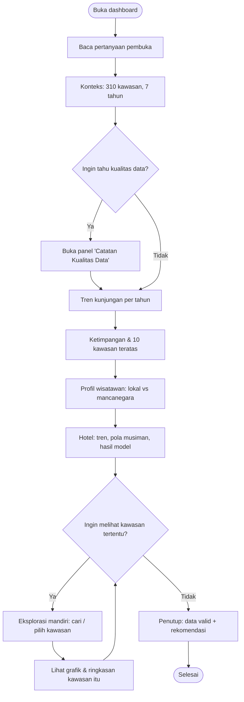
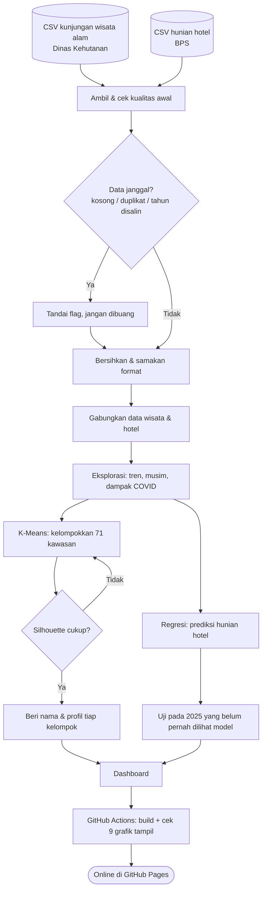
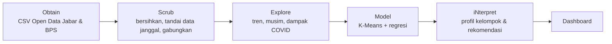

# Pariwisata Alam Jawa Barat: Analisis Data

**Siapa yang benar-benar mengunjungi hutan Jawa Barat?** Proyek ini menelusuri data kunjungan **310 kawasan wisata alam** (2016–2022) dan **tingkat hunian kamar (TPK) hotel** (2019–2025) di Jawa Barat. Hasilnya disajikan sebagai dashboard bercerita.

**Dashboard:** https://rivaldimhr.github.io/jabar-tourism/ (bisa langsung dicoba, tanpa instalasi)


## Singkatnya

Data kunjungan wisata alam Jawa Barat ternyata **lebih banyak bercerita tentang siapa yang rajin melapor daripada siapa yang berkunjung**. Proyek ini membersihkan data tersebut, menandai tahun-tahun yang tidak bisa dipercaya, lalu menjawab tiga pertanyaan:

1. Kawasan mana yang benar-benar ramai, dan mana yang hanya terdaftar?
2. Seberapa besar dampak COVID, baik ke wisata alam maupun ke hotel?
3. Kawasan mana yang perlu dikembangkan dan mana yang perlu dievaluasi?

## Diagram aktivitas: memakai dashboard



## Diagram aktivitas: dari data mentah ke dashboard



## Temuan utama

- **Ketimpangan ekstrem.** TWA Tangkubanparahu menyumbang **33,4%** seluruh kunjungan tercatat, dan 5 kawasan teratas menyumbang **75,6%**. Sebanyak **224 kawasan** tidak pernah mencatat satu pengunjung pun.
- **Hampir semuanya wisatawan lokal.** Wisatawan mancanegara hanya **1,9%** dari total kunjungan.
- **Masalah data lebih besar dari masalah pandemi.** Penurunan 98% dari 2016 ke 2017 terjadi karena banyak kawasan berhenti melapor, bukan karena pengunjungnya hilang. Data 2020 identik dengan 2019, sehingga diduga hasil salin. Pada 2022 hanya satu kawasan yang melapor.
- **Hotel ikut terpukul saat COVID.** Rata-rata hunian hotel berbintang turun dari 53% (2019) ke 35% (2020). Bulan terpadat adalah **Desember**, yang tersepi **April–Mei**.


## Model

### 1. Pengelompokan kawasan (K-Means, k = 4)

Model ini mengelompokkan 71 kawasan yang punya data kunjungan, berdasarkan rata-rata pengunjung per tahun, jumlah tahun aktif melapor, dan rasio wisatawan mancanegara.

| Kelompok | Jumlah | Ciri | Contoh |
|---|---|---|---|
| Unggulan terkelola | 13 | ±50 rb pengunjung/tahun, rutin melapor | Tangkubanparahu, Tahura Djuanda |
| Potensi tersembunyi | 8 | ±9 rb/tahun, jarang melapor | TN Gede Pangrango, Halimun-Salak |
| Andalan lokal | 5 | ±3 rb/tahun, rutin melapor | Curug Cimahi, Citumang |
| Perlu evaluasi | 45 | ±4 rb/tahun, hampir tidak pernah melapor | Curug Cisuren, Curug Cigentis |

**Silhouette score: 0,67.** Kelompoknya cukup terpisah. k = 5 sedikit lebih tinggi (0,68), tetapi k = 4 dipilih karena tiap kelompoknya lebih mudah dijelaskan.

### 2. Prediksi hunian hotel (regresi linear)

Fitur yang dipakai: tren tahun, pola bulan (sin/cos), dan penanda masa COVID. Model dilatih pada data 2019–2024 (72 bulan) dan diuji pada 2025 (12 bulan) yang belum pernah dilihatnya.

| Metrik (uji 2025) | Nilai |
|---|---|
| MAE | **3,3 poin persen** |
| RMSE | 4,5 poin persen |
| R² | 0,11 (latih: 0,51) |

Artinya, prediksinya rata-rata meleset sekitar 3 poin dari hunian sebenarnya (misalnya memprediksi 38% saat aktualnya 41%). Model ini cukup baik menangkap tingkat rata-rata dan pola musim, tetapi lemah menebak naik-turun antarbulan, sehingga R² ujinya rendah. Model ini dipakai untuk **menjelaskan pola**, bukan untuk peramalan yang presisi. Dari koefisiennya:

- Masa COVID menurunkan hunian sekitar 12,5 poin per bulan.
- Desember–Januari lebih ramai dibanding bulan lain.


## Cara membaca dashboard

Dashboard disusun sebagai cerita dari atas ke bawah:

1. **Konteks dan kualitas data.** Buka panel kuning "Catatan Kualitas Data" untuk melihat tahun mana yang bermasalah.
2. **Tren keseluruhan.** Grafik kunjungan wisatawan nusantara (wisnus) dan mancanegara (wisman) per tahun.
3. **Ketimpangan dan kawasan unggulan.**
4. **Profil wisatawan.**
5. **Hotel.** Berisi tren hunian per tahun, pola musiman, dan hasil model. Pada grafik model, area hijau adalah tahun uji (2025).
6. **Eksplorasi mandiri.** Pilih kawasan mana pun untuk melihat datanya sendiri.
7. **Penutup.** Hanya memakai tahun yang datanya bisa dipercaya, plus rekomendasi.

## Alur pengerjaan (OSEMN)



| Langkah | File |
|---|---|
| Obtain | `notebooks/01_obtain_data.py` |
| Scrub | `notebooks/02_scrub_final.ipynb` |
| Explore | `notebooks/03_explore_viz.py` |
| Model | `notebooks/04_model.ipynb` |
| Interpret | `notebooks/05_interpret.ipynb` |

Hasil tiap langkah disimpan di `data/` (raw → processed → clean), `outputs/figures/`, dan `outputs/model_results/`.

### Menjalankan sendiri

```bash
pip install pandas numpy matplotlib seaborn plotly scikit-learn jupyter
# jalankan notebook 01 → 05 berurutan, lalu:
python -m http.server 8000      # dari folder repo
# buka http://localhost:8000/dashboard/dashboard.html
```

Dashboard perlu dibuka lewat server lokal (bukan klik dua kali file HTML-nya) karena membaca file CSV.

Situs online dibangun otomatis oleh `.github/workflows/pages.yml`. Workflow itu juga membuka dashboard di browser untuk memastikan semua grafik tampil tanpa error.

## Keterbatasan

- Data kunjungan bergantung pada laporan pengelola. Banyak kawasan tidak melapor, sehingga angka total lebih mencerminkan kepatuhan melapor daripada jumlah pengunjung sebenarnya.
- Data TPK hotel 2022 hanya lengkap untuk hotel berbintang, dan 2023 hanya 4 bulan. Pada grafik model, bulan yang kosong tampil sebagai garis lurus hasil interpolasi.
- Model regresi sederhana dengan R² uji rendah. Gunakan untuk memahami pola, bukan sebagai angka pasti.

## Tim

Tugas Besar **II4013 Data Analitik** ITB, Kelompok 12:

- Bastian Natanael Sibarani: integrasi sistem, logika dashboard, visualisasi.
- Gabriel Marcellino: inisialisasi proyek, *data scrubbing*, eksplorasi data hotel.
- Faishal: narasi teknis, model ML, visualisasi tren.
- Gymnastiar: data *processed* dan analisis awal.
- Rivaldi: materi presentasi dan desain dashboard.

Sumber data: Open Data Jawa Barat (Dinas Kehutanan) dan BPS Jawa Barat.
